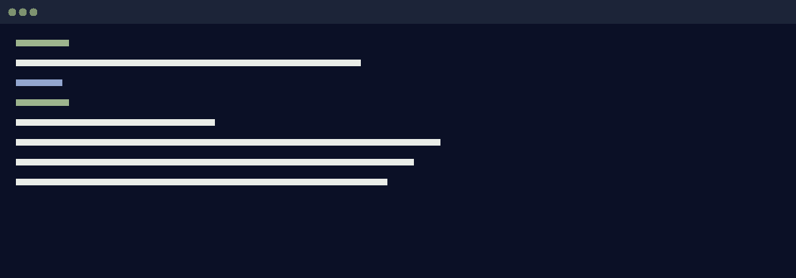

## 問題

這篇用課堂 lab 提供的手機訊息資料庫，在 macOS 上以 `sqlite3` 操作。同一個資料庫，兩種開法，查到的訊息筆數不一樣。差的那幾十筆不會有任何錯誤訊息提醒你，查詢就是安靜地跑完。

> 補充
> 這是一篇示範用的草稿：文字與指令是為了展示版型而寫，不是真實的文章。

## 重現

1. 先替三個檔案算 hash，留下動手之前的狀態。
2. 只複製主檔到另一個資料夾，查一次筆數。
3. 三個檔案一起複製，再查一次。

```bash {6}
# 動手之前：三個檔案一起算
shasum -a 256 sms.db sms.db-wal sms.db-shm > before.sha256

# 只帶主檔
cp sms.db only-main/
sqlite3 only-main/sms.db "SELECT COUNT(*) FROM message;"
```

```output
996
```



行內的程式碼長這樣：`PRAGMA journal_mode;`，字級比內文小一點，底色和引言帶同一個淡綠。

> 注意
> 用唯讀模式開啟不會動到主檔，但資料夾裡會多出一個你沒有放進去的索引檔。兩種開法都會改變東西。

## 正確的做法

```python title="verify.py" {2,5-6,9}
import hashlib, pathlib
NAMES = ("sms.db", "sms.db-wal", "sms.db-shm")

def digest(path):
    data = pathlib.Path(path).read_bytes()
    return hashlib.sha256(data).hexdigest()

for name in NAMES:
    print(name, digest(name))
```

這張圖不是寬版，只在內文欄寬內：


 

兩張圖寫在同一段就會並排，各佔一個編號；手機上會上下堆疊。

> “Every action leaves a trace.”
> 『每個動作都會留下痕跡。』

## 後記

寫每一篇實作文，最後留一段給沒走通的路和當下的想法。這一段回到和隨筆一樣的語氣。

## 參考資料

1. [SQLite: Write-Ahead Logging](https://www.sqlite.org/wal.html)，sqlite.org
2. 課堂 lab 講義（未公開）

---

#示範草稿　#實作
